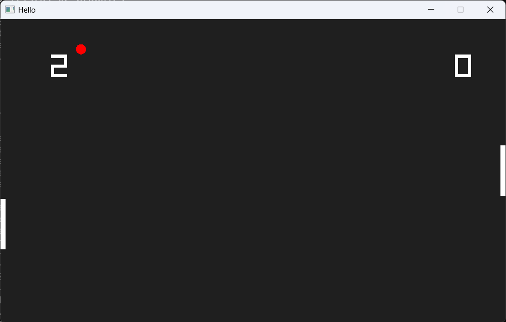

# Swift Raylib Pong Clone


A simple Pong game implemented in Swift using the Raylib library. It demonstrates basic game mechanics, including ball movement, paddle control and simple C interoperability of Swift with Raylib.



It does not use Foundation, so it should be able to run on pretty much any platform that Raylib supports (with added benefit of being just ~6.5MB in size).

> [!NOTE]
> This is my first time using Swift, so the code may not be idiomatic. If you have any suggestions for improvement, feel free to open an issue or a pull request.

### Building

Please ensure you have Swift and other necessary tools installed on your system. You can build the project using the command below:
```bash
swift build -c release -Xswiftc -static-stdlib
```

> [!IMPORTANT]
> You'll need to copy `assets` folder to the build directory (e.g., `.build/release`) for the game to run properly, as it contains the necessary sound files.

No AI has been used to generate any of this code.

### License
This project is licensed under the ISC License. See the [LICENSE](LICENSE) file for details.